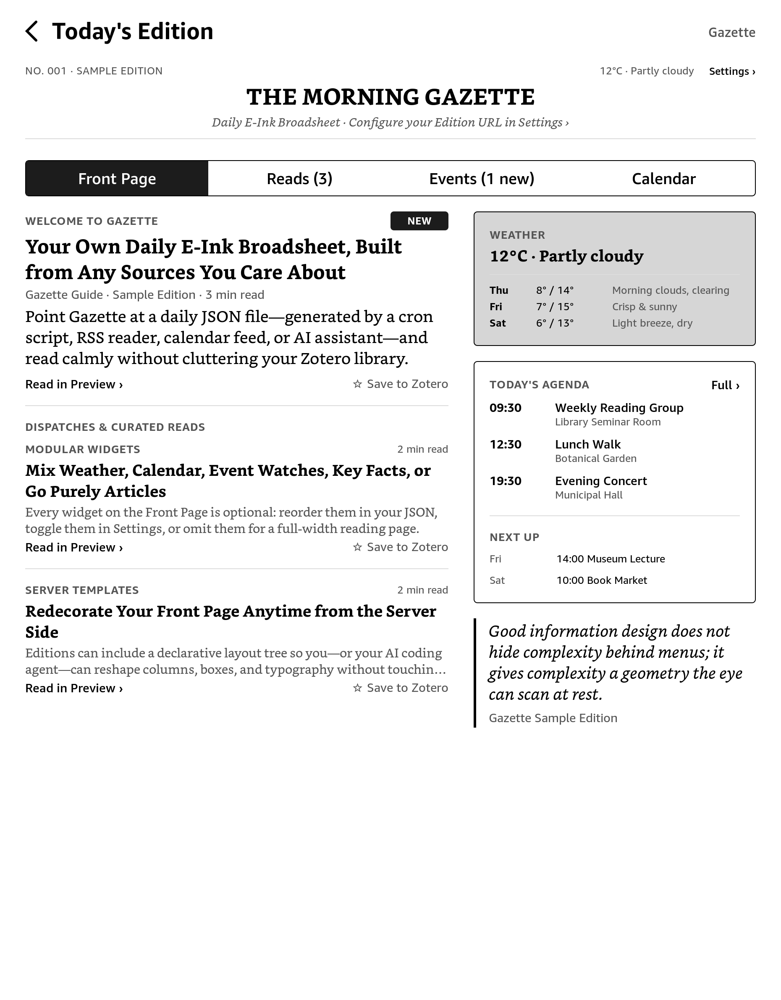

# Gazette

A personal daily e-ink newspaper for [Zotero for Kindle](https://github.com/ievlevpn/zotero-for-kindle).

Gazette renders a single daily **Edition JSON** file as a calm broadsheet on your Kindle: curated reads on the left, optional widgets on the right (weather, personal calendar, local event watches, key facts, notes, or quotes), and custom sections across the top. Nothing is added to your Zotero library unless you choose to save a piece.



## Install

On your Kindle (Zotero for Kindle 0.12.0 or later):

1. Open **Settings → Plugins → Get plugins → Gazette → Install** and turn it on.
2. Open **Plugins → Gazette** from Home to browse the built-in Sample Edition.
3. Connect your own daily Edition JSON via **Settings ›** (in the masthead) or `settings.json`.

> **Tip (Preview highlights & Save on Back):** Tapping any story opens clean HTML in the app's native Preview reader without touching Zotero. On Zotero for Kindle **0.15.4+**, you can highlight and add notes while reading in Preview, then tap **Save** in the reader menu (or confirm **Save** when pressing Back) to create a Zotero item with all your highlights attached as a Zotero note.

---

## Quick Setup with Your AI Agent

The fastest way to build your own daily newspaper (using a Mac, Raspberry Pi, or any home server — plus your existing `claude` or `gemini` CLI subscription for ~1 curation query a day) is to paste this prompt into your AI coding agent:

```text
Set up Gazette (https://github.com/ievlevpn/zk-gazette) as my personal daily e-ink newspaper on this machine:

1. Clone https://github.com/ievlevpn/zk-gazette into ~/gazette-src and copy generator/ into ~/gazette/.
2. Ask me:
   - My city (for Open-Meteo weather) and preferred newspaper title
   - Whether I want my calendar included (Google/Apple private .ics URL)
   - Any local venues, concert halls, seminars, or event pages I want watched
   - My favorite RSS feeds / blogs and topics I enjoy
   - How I want to deliver today.json to my Kindle:
     (a) serve today.json over HTTPS (e.g. GitHub Pages, Cloudflare, or my web server) and enter that URL in Gazette → Settings, OR
     (b) push directly to my Kindle's Gazette data/edition.json over SSH.
3. Write ~/gazette/config.json (keep it private, never commit it), test `python3 ~/gazette/generate.py --config ~/gazette/config.json`, verify the generated today.json is valid, and install a daily 06:30 cron job.
```

### Redecorate Your Front Page Anytime

Because Gazette supports **server-side declarative layouts** (`layout` in the Edition JSON, generated by `generator/template.py`), you never have to rebuild the Kindle plugin to change how your newspaper looks. Just ask your AI agent:

```text
Edit ~/gazette/template.py to redecorate my Gazette Front Page:
- Move Weather to a horizontal box across the top under the masthead
- Keep the Lead story full-width, with 2 dispatches and my Calendar side-by-side underneath
- Remove the Quote widget
Then run ~/gazette/generate.py so I can preview today.json.
```

---

## Manual Setup

The included [`generator/`](generator/) uses **Python 3 standard library only** (zero `pip install` needed):

```sh
cp generator/config.example.json generator/config.json
# Edit generator/config.json with your city, feeds, optional .ics calendar URLs, and watched pages
python3 generator/generate.py --config generator/config.json
```

Schedule it daily with `cron`:

```cron
30 6 * * * PATH=/opt/homebrew/bin:/usr/local/bin:/usr/bin:/bin /usr/bin/python3 /path/to/generator/generate.py --config /path/to/generator/config.json >> /path/to/generator/logs/gazette.log 2>&1
```

### Delivery Options

Gazette checks two sources automatically:

1. **HTTPS URL (recommended for most users):** Host `today.json` at any HTTPS URL and paste it in **Gazette → Settings ›** (or `settings.json`, see [`settings.example.json`](settings.example.json)). Gazette refreshes hourly in the background and shows a **"New edition"** badge on Home when a new `id` arrives.
2. **Local drop (`data/edition.json`):** For completely private editions (e.g., personal calendars on a home server), push `today.json` over SSH or USB directly to `<plugin-data-dir>/edition.json` (Gazette reads it via `zk.files` with zero public exposure).

---

## Edition JSON Schema (`edition: 1`)

Any script or service can produce a Gazette edition. Only `title`, `dateLine`, and `tabs` are required:

```json
{
  "edition": 1,
  "id": "2026-11-26",
  "number": "No. 042",
  "city": "Zurich",
  "title": "THE MORNING GAZETTE",
  "dateLine": "Thursday, 26 November 2026",
  "subtitle": "Curated at 06:30",
  "weather": "12°C · Partly cloudy",
  "widgets": [
    {
      "id": "weather",
      "kind": "weather",
      "title": "Weather",
      "current": "12°C · Partly cloudy",
      "days": [{ "day": "Thu", "temp": "8° / 14°", "desc": "Clearing" }]
    },
    {
      "id": "agenda",
      "kind": "agenda",
      "title": "Today",
      "tabId": "calendar",
      "today": [{ "time": "09:30", "title": "Seminar", "place": "Room 101" }],
      "upcoming": [{ "day": "Fri", "time": "19:30", "title": "Concert" }]
    },
    {
      "id": "facts",
      "kind": "facts",
      "title": "At a Glance",
      "items": [{ "label": "Books read", "value": "14", "note": "this year" }]
    },
    {
      "id": "note",
      "kind": "note",
      "title": "Daily Note",
      "body": "Any short reminder, poem, or briefing."
    },
    {
      "id": "quote",
      "kind": "quote",
      "text": "A short epigraph.",
      "source": "Author"
    }
  ],
  "tabs": [
    {
      "id": "reads",
      "title": "Reads",
      "kind": "articles",
      "items": [
        {
          "id": "story-1",
          "lead": true,
          "isNew": true,
          "kicker": "ESSAY",
          "title": "Headline",
          "source": "Publication",
          "author": "Author",
          "date": "2026-11-26",
          "url": "https://example.com/article",
          "readTime": "5 min read",
          "summary": "Short front-page deck.",
          "whyNote": "Why this made today's edition.",
          "tags": ["essay"],
          "html": "<!doctype html><html><body><h1>Headline</h1><p>...</p></body></html>"
        }
      ]
    }
  ]
}
```

### Supported Widgets & Tabs

- **Front Page widgets (`widgets`):** `weather`, `agenda`, `listings`, `facts`, `note`, `quote`. Pass `"widgets": []` for an articles-only broadsheet with no sidebar, or omit `widgets` to let Gazette auto-compose a rail from your tabs. Every widget can also be toggled on/off in **Settings ›**.
- **Tabs (`tabs`, up to 4):** `articles` (reads with All/Unread/Saved filters), `listings` (filterable events/watches with `NEW` badges), `agenda` (today + week + weather), and `briefs` (bulleted summaries).
- **Custom server-side layout (`layout`):** Optional `{ portrait?, landscape?, compact? }` tree of declarative nodes (`column`, `row`, `box`, `text`, `pill`, `divider`, `space`, `spacer`, `notice`, `quote`, `widget`, `article`). See [`src/schema.ts`](src/schema.ts) and [`generator/template.py`](generator/template.py).

## Settings

Tap **Settings ›** in Gazette's masthead:

- **Edition JSON URL** — any `https://` endpoint returning an Edition JSON (leave blank to use local `data/edition.json` or the Sample Edition).
- **Masthead override** — optional custom title.
- **Zotero tags** — comma-separated tags added when you explicitly save a piece.
- **Front Page Widgets** — tap chips to show or hide individual widgets.
- **When closing a previewed article** — choose *Ask only if highlighted* or *Always ask Save or Discard* (app 0.15.4+).

## Permissions

- `net:*` — fetch your configured Edition JSON URL.
- `background` — check for a fresh edition after sync (at most hourly) and badge the Plugins icon.
- `zotero:create-items`, `zotero:notes`, `zotero:tags` — used **only** when you explicitly choose to save an article (and any Preview highlights) to Zotero.

## Build

```sh
npm install
npm run check
npm run build
```
